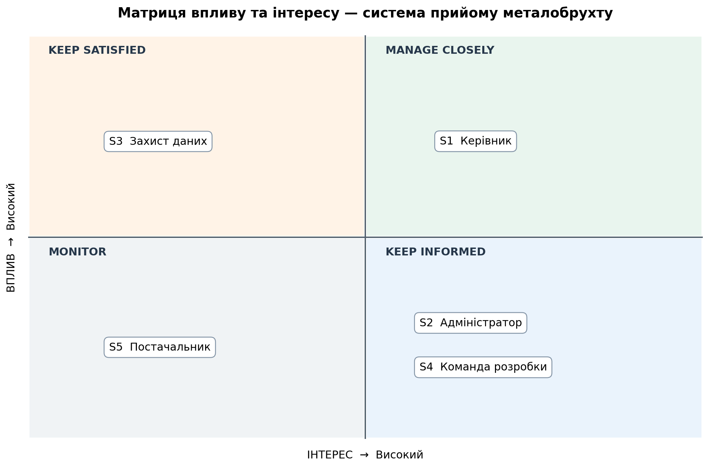

# Лабораторна робота №13
**Тема:** Аналіз стейкхолдерів та план комунікацій
**Тема кваліфікаційної роботи:** «Розробка веборієнтованої інформаційної системи автоматизації обліку та управління операціями прийому металобрухту»

## Мета роботи
Визначити зацікавлені сторони проєкту, оцінити їхній вплив та інтерес і спланувати комунікації.

## Крок 1. Ідентифікація стейкхолдерів
Усі ролі наведено як **модельні учасники навчального проєкту**, а не як підтверджені працівники конкретного підприємства.

| ID | Стейкхолдер | Чому важливий |
|---|---|---|
| S1 | Керівник підприємства / замовник | Визначає бюджет, затверджує вимоги та приймає результат. |
| S2 | Адміністратор пункту прийому | Щоденно працюватиме з клієнтами, цінами та операціями. |
| S3 | Фахівець із захисту даних / комплаєнсу | Перевіряє законність обробки персональних даних і вимоги безпеки. |
| S4 | Команда розробки | Реалізує модулі, усуває помилки та відповідає за технічну якість. |
| S5 | Потенційний постачальник металобрухту | Зацікавлений у зручності обслуговування, але не ухвалює рішень щодо розробки. |

## Крок 2. Матриця Power/Interest
Оцінки високий/низький є експертними припущеннями для навчального проєкту.

| Стейкхолдер | Вплив | Інтерес | Стратегія |
|---|---|---|---|
| S1 — Керівник підприємства / замовник | Високий | Високий | Manage Closely |
| S2 — Адміністратор пункту прийому | Низький | Високий | Keep Informed |
| S3 — Фахівець із захисту даних / комплаєнсу | Високий | Низький | Keep Satisfied |
| S4 — Команда розробки | Низький | Високий | Keep Informed |
| S5 — Потенційний постачальник металобрухту | Низький | Низький | Monitor |

## Крок 3. План комунікацій

| Стейкхолдер | Що повідомляємо | Формат і канал | Частота | Відповідальний |
|---|---|---|---|---|
| Керівник підприємства (S1) | Прогрес етапів, витрати, ризики, рішення щодо вимог | Email-звіт + онлайн-зустріч | Раз на тиждень; окремо при критичному ризику | Project Manager |
| Фахівець із захисту даних (S3) | Схема зберігання даних, права доступу, результати перевірки | Email + погодження документа | На етапі проєктування та перед релізом | Project Manager / Backend-розробник |
| Адміністратор пункту прийому (S2) | Прототип інтерфейсу, сценарії прийому, зміни у функціях | Демонстрація + форма зворотного зв’язку | Раз на 2 тижні | UI/UX-дизайнер / Project Manager |

## Контрольні запитання

**1. Чому кінцеві користувачі B2B-продукту часто належать до Keep Informed?**
Працівники пункту прийому безпосередньо використовують систему та можуть помітити незручності, тому мають високий інтерес. Проте бюджет і ключові рішення зазвичай затверджує керівництво, тому їхній формальний вплив нижчий. Їх слід регулярно інформувати й залучати до тестування.

**2. Що означає Keep Satisfied і яка типова помилка PM?**
Це означає вчасно надавати стислу інформацію про питання, важливі для такого стейкхолдера, та погоджувати рішення, які він може заблокувати. Помилка — надсилати щоденні технічні деталі або, навпаки, звернутися лише перед релізом, коли вже пізно виправляти невідповідності.

**3. Чому реєстр стейкхолдерів може бути конфіденційним?**
Внутрішній реєстр може містити оцінки реального впливу, ставлення до змін, конфлікти інтересів, особисті контакти та тактику переговорів. Публікація таких оцінок може зіпсувати відносини та порушити приватність. Команді передають лише інформацію, необхідну для її роботи.

**4. Асинхронна та синхронна комунікація**
Асинхронна комунікація (email, Jira) не вимагає одночасної присутності та зручна для звітів, документів і фіксації рішень. Синхронна (зустріч, дзвінок) дає швидке обговорення та потрібна для спірних вимог, блокерів і термінових рішень.

**5. Приклад інформаційного шуму**
Якщо PM щодня надсилає директору десять повідомлень про кожну дрібну зміну кнопок, важливе повідомлення про ризик втрати даних може загубитися. Краще робити короткий щотижневий звіт, а про критичні проблеми повідомляти негайно.

## Висновок
Визначено п’ять стейкхолдерів, розподілено їх за матрицею Power/Interest та розроблено план комунікацій для трьох учасників із різних квадрантів. Це допомагає узгоджувати вимоги, своєчасно отримувати зворотний зв’язок і зменшувати ризик непорозумінь.
